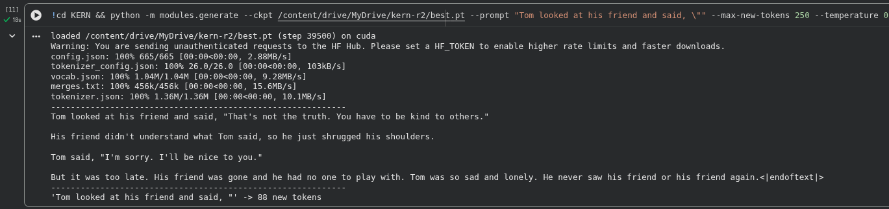

# KERN

KERN is a decoder-only transformer written from scratch in PyTorch. It is a
learning project built while following Stanford CS336.

The model has 29,920,512 parameters and was trained on
[TinyStories](https://huggingface.co/datasets/roneneldan/TinyStories). It
writes short, simple stories. That is all it does.

Multi-head attention is divided attention:

https://github.com/user-attachments/assets/b09c842e-3bb7-44f6-9b0b-c641896c7a21

## The model

KERN-GPT is a small LLaMA-style model:

- 6 layers, width 384, 6 attention heads of 64
- SwiGLU feed-forward with hidden width 1024
- RMSNorm before attention and before the feed-forward
- RoPE applied to queries and keys, with no positional embedding at the input
- no bias terms
- output projection tied to the token embedding
- context length 256
- vocabulary 50,257 (GPT-2 BPE)

The embedding matrix is 64% of the parameters. It is initialised with
std=0.02. This is required. With PyTorch's default N(0,1) initialisation and
tied weights, the logit for the correct token is the embedding vector dotted
with itself, so it dominates every other logit. The model reports 100%
accuracy before training, and every gradient is zero. The std=0.02 init is
what fixes that.

## What is in the repository

`modules/` has one file per part, in the order they were built:

- `softmax.py`: softmax
- `attention.py`: scaled dot-product attention
- `mask.py`: causal mask
- `mha.py`: multi-head attention
- `rope.py`: rotary position encoding
- `rmsnorm.py`: RMSNorm
- `swiglu.py`: SwiGLU
- `block.py`: transformer block
- `kern1.py`: full model

`modules/data/` handles the GPT-2 BPE tokenizer, downloads TinyStories, and
turns the token stream into next-token pairs. The prepared tensors are stored
as `uint16`.

`modules/train.py` is the training loop: AdamW, linear warmup then cosine
decay, gradient clipping at 1.0, mixed precision, checkpoint/resume, and a
weights-only `best.pt` for the best validation loss.

## Training

The data is TinyStories, tokenised with GPT-2's BPE. 95% of the tokens are
used for training and 5% for validation.

Training ran twice on free Colab T4s, at batch size 32 and block size 256, so
8,192 tokens per step. The run used fp16 and measured 3.3 steps/s (about
27,000 tokens/s).

The final run used 500,000 stories: 112.3M tokens in total, 106.7M for
training. It ran for 40,000 steps (about 3.1 epochs). Best validation loss was
1.0173 at step 39,500; the final value was 1.0212.

A full checkpoint with the model, optimizer and scaler is 343 MB. `best.pt` is
115 MB.

## Example



The formatting holds up: paragraphs, quotation marks, punctuation, and the
closing `<|endoftext|>` token. There is a cause and an effect, too: Tom
apologizes too late, his friend leaves, and Tom is left alone.

## Running it

Python 3 and PyTorch. From the repository root:

```bash
python3 -m venv .venv
.venv/bin/pip install torch transformers datasets

.venv/bin/python -m modules.data.prepare --n-stories 500000 --out data
.venv/bin/python -m modules.train --steps 40000 --batch-size 32 --amp \
    --eval-every 250 --max-eval-batches 25 --save-every 1000 \
    --data data --out runs/kern
```

A free Colab T4 (15 GB) is enough for batch size 32 and context 256. On a
smaller GPU, lower the batch size.

Checkpoints go to `runs/kern/checkpoint.pt`, and `--resume` continues from one.
`best.pt` is rewritten whenever validation loss improves.

To sample from a checkpoint:

```bash
.venv/bin/python -m modules.generate --ckpt runs/kern/best.pt \
    --prompt "Once upon a time" --max-new-tokens 200
```

## Status

The training loop works and the model is trained. `best.pt` produces
TinyStories-style text.
